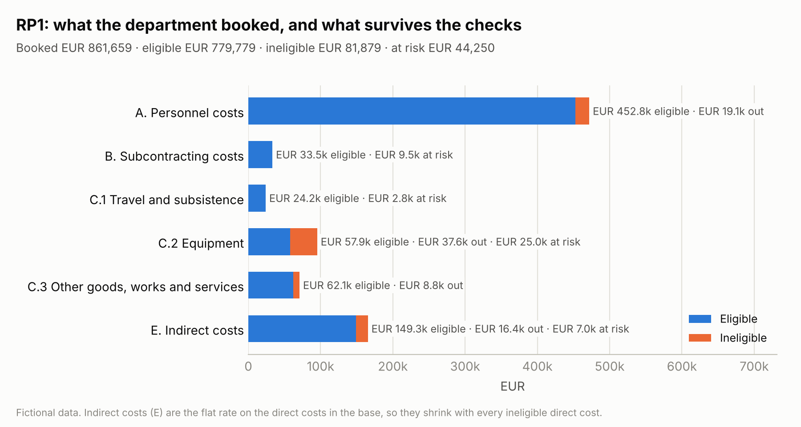
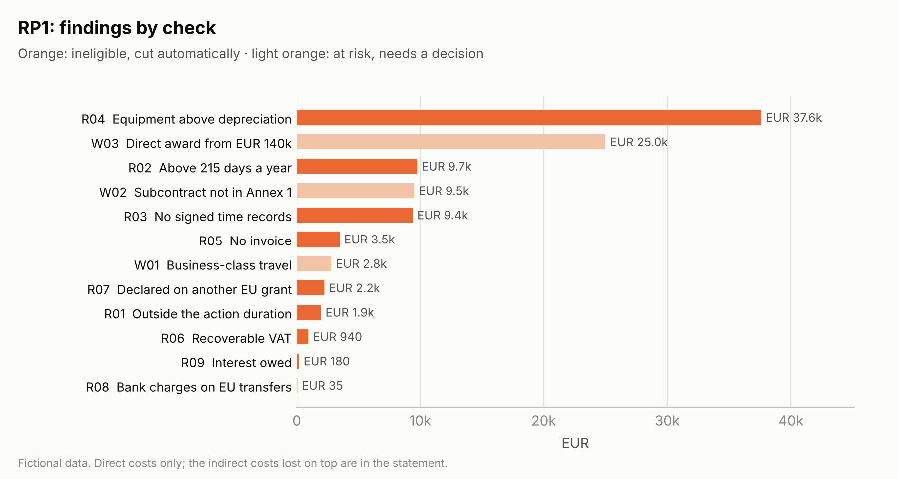
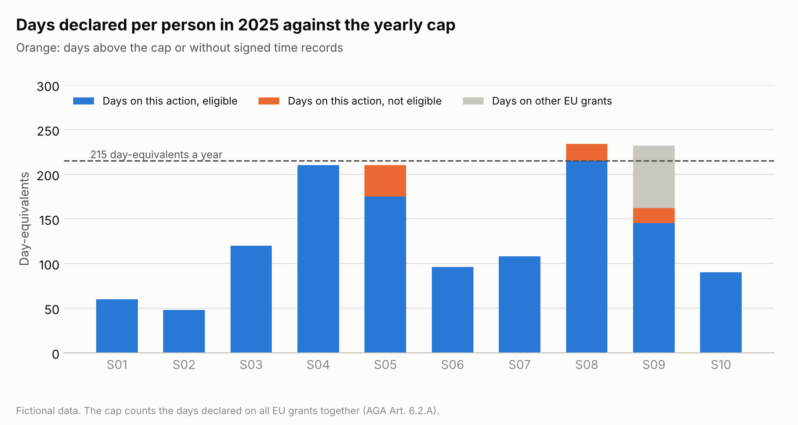
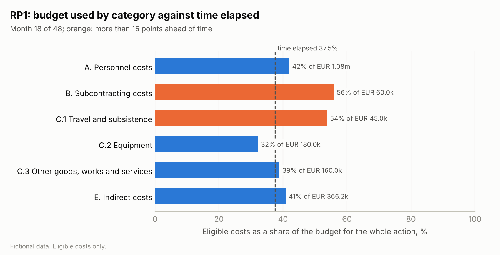
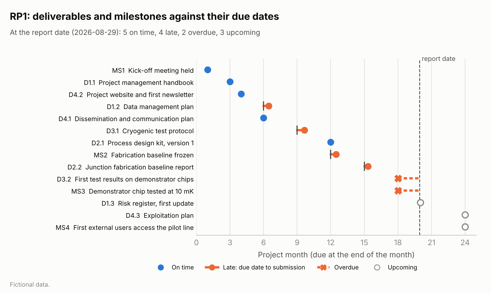

# Cost eligibility and reporting for EU-funded research projects

*Hatef Tabbakhian · November 2026 · fictional project data; rules from the EU grant agreement and Italian law*

> **In breve.** Lo strumento legge la contabilità di un dipartimento universitario su un progetto
> europeo (costi, timesheet, costo del personale), applica le regole di ammissibilità dei costi di
> Horizon Europe e la normativa italiana sugli acquisti, e produce il rendiconto finanziario, l'elenco
> delle non conformità con l'articolo di riferimento e l'azione correttiva, l'analisi del budget e
> dell'impegno per work package, lo stato di deliverable e milestone, il calendario delle scadenze
> di rendicontazione con la verifica del certificato di audit, e una bozza di relazione periodica.
> Le [linee guida per il personale](docs/linee_guida_rendicontazione.md) e il
> [glossario italiano-inglese](docs/glossario_it_en.md) spiegano le stesse regole in pratica.
> Dati di esempio inventati.

Two jobs come back in every EU-funded research project: collecting and analysing project data for
the periodic reports, and checking that each cost meets the eligibility rules of the programme.
This repository does both for one partner of a fictional project. It reads the department's ledger,
time records, staff costs and deliverables; applies the eligibility rules with the article behind
each check; and produces the financial statement, a log of findings with the action to take,
budget, effort and deliverable figures, the calendar of reporting deadlines with the audit
certificate check, and a draft periodic report.

The demo partner is a university physics department in QPL-DEMO, an invented 48-month pilot line
for superconducting quantum devices, in reporting period 1 (January 2025 to June 2026). It is set up
like a Chips JU research and innovation action: Horizon Europe cost rules, an EU contribution of 50%
of the eligible costs, and the rest from national co-funding or the beneficiary's own resources.
The data contains 18 cost problems of the kinds audits find; the tests check that the tool finds all
of them.

## What survives the checks



- **The department booked EUR 861,659; EUR 779,779 is eligible.** EUR 81,879 (9.5%) is cut and
  EUR 44,250 more is at risk until someone takes a decision or files a document.
- **The largest single error is equipment declared at its full price.** A EUR 48,000 signal
  generator can only be charged as 16 months of depreciation in this period (EUR 12,800), which
  removes EUR 35,200.
- **Every ineligible direct cost costs 25% more.** Indirect costs are a flat rate on the direct
  costs, so the cuts above also remove EUR 16,376 of indirect costs.
- **Personnel: EUR 19,098 is ineligible across four people**, either for days above the yearly cap
  or for months without signed time records.

## Who pays

| | EUR |
| --- | ---: |
| Eligible costs, reporting period 1 | 779,779 |
| EU contribution requested (50%) | 389,890 |
| Left to national co-funding or own resources | 389,890 |

Most Chips JU calls are co-funded by the Joint Undertaking and the participating states, so part
of the half the EU does not pay can come from national funds, reported again under national rules
and deadlines. In the real SUPREME pilot line, for example, CORDIS lists the University of Naples
Federico II with EUR 700,000 of costs and a EUR 350,000 EU contribution.

## The checks

| Check | Finds | Reference |
| --- | --- | --- |
| R01 | Cost incurred outside the action duration | AGA Art. 6.1(a)(ii) |
| R02 | Days above 215 day-equivalents a year across EU grants | AGA Art. 6.2.A |
| R03 | Time not supported by signed monthly time records | AGA Art. 6.1(a)(v); MGA Art. 20 |
| R04 | Equipment declared above the depreciation for the period | AGA Art. 6.2.C.2 |
| R05 | No invoice or other supporting document | AGA Art. 6.1(a)(v) |
| R06 | Deductible or refundable VAT | AGA Art. 6.3(a) |
| R07 | Cost already declared under another EU grant | AGA Art. 6.3(b) |
| R08 | Bank charges on transfers from the granting authority | AGA Art. 6.3(a) |
| R09 | Interest owed | AGA Art. 6.3(a) |
| W01 | Travel above the institution's travel rules (at risk) | AGA Art. 6.2.C.1; Art. 6.3(a) |
| W02 | Subcontract not set out in Annex 1 (at risk) | AGA Art. 6.2.B; MGA Art. 5.5 |
| W03 | Direct award at or above EUR 140,000 (at risk) | D.Lgs. 36/2023, Art. 50(1)(b) and (e) |

R-checks cut the cost automatically; W-checks put it at risk and say what decision is needed.
Every finding is in `reports/RP1_issues_log.csv` with the line, the amount, the reason and the action.



## Personnel costs

Personnel costs are declared as daily rate × days worked, with daily rate = annual personnel costs
/ 215, rounded to half-days. Nobody can declare more than 215 days a year across all EU grants, and
every month needs a time record signed by the person and the supervisor. Days worked in 2026 are
costed at the 2025 rate, because 2025 is the last closed financial year when the report is prepared.



S08 declared 234 days in 2025, 19 above the cap. S09 declared 162 days here plus 70 on another EU
grant: 17 days too many. S05 and S10 have months without signed records.

## Budget and effort



At month 18 of 48 (37.5% of the action) the partner has used 41.2% of its total budget. Travel
(54%) and subcontracting (56%, including the subcontract still awaiting approval) are running
ahead; budget transfers between categories are possible without an amendment as long as Annex 1
does not change substantially (MGA Art. 5.5).

| Work package | Planned person-months (action) | Expected by now | Eligible so far |
| --- | ---: | ---: | ---: |
| WP1 Project management | 40 | 15.0 | 9.0 |
| WP2 Device fabrication | 100 | 37.5 | 42.3 |
| WP3 Cryogenic testing | 100 | 37.5 | 51.7 |
| WP4 Dissemination and exploitation | 20 | 7.5 | 4.8 |

WP3 is consuming effort faster than planned, while project management and dissemination are
behind: either the time is not being recorded, or the work is late.

## Deliverables and milestones



At the report date (29 August 2026, the day the periodic report is due) 5 of the 11 items due were
on time, 4 were late (15 days on average) and 2 are overdue: the first test results on demonstrator
chips (D3.2) and the matching milestone (MS3), both due in month 18. Together with the effort
running ahead in WP3, this is the point the technical report has to explain.

## Reporting calendar and audit certificate

| Reporting period | Ends | Report due | Payment by |
| --- | --- | --- | --- |
| RP1 | 30 Jun 2026 | 29 Aug 2026 | 27 Nov 2026 |
| RP2 | 31 Dec 2027 | 29 Feb 2028 | 29 May 2028 |
| RP3, with the final report | 31 Dec 2028 | 1 Mar 2029 | 30 May 2029 (balance) |

- **Deadlines.** The periodic report is due 60 days after each reporting period ends, and the
  granting authority pays within 90 days of receiving it (MGA Art. 21 and 22; the Data Sheet of
  each grant sets the time limits). Each beneficiary fills in and signs its own financial statement
  in the Funding & Tenders Portal; the coordinator assembles the report and submits it.
  Deliverables and milestones are reported continuously.
- **Audit certificate.** A certificate on the financial statements (CFS) comes with the final
  report when the EU contribution requested for actual costs reaches EUR 430,000 over the whole
  action; flat-rate indirect costs do not count (MGA Art. 24). An independent auditor issues it;
  a public body can use a competent and independent public officer. The demo partner has requested
  EUR 315,262 so far, 73% of the threshold, and at this pace reaches about EUR 840,000: the audit
  fee belongs in the budget now.
- **After the balance.** Audits can start for 2 more years and records are kept for 5 years: in the
  demo, until May 2031 and May 2034 (MGA Art. 25 and 20).

The draft report (`reports/RP1_report.md`) turns all these figures into points for the coordinator.

## Guidelines and glossary

- [`docs/linee_guida_rendicontazione.md`](docs/linee_guida_rendicontazione.md): guidelines for
  project staff, in Italian
- [`docs/cost_reporting_guidelines.md`](docs/cost_reporting_guidelines.md): the same in English
- [`docs/rules_reference.md`](docs/rules_reference.md): every rule with its source, including the
  Italian rules for procurement (D.Lgs. 36/2023) and for projects on EU cohesion funds
  (DPR 66/2025, 1,720-hour rate)
- [`docs/glossario_it_en.md`](docs/glossario_it_en.md): Italian-English glossary of grant reporting

## Run it

```bash
pip install -r requirements.txt
python -m grantcheck --period RP1                    # reports/ and reports/figures/
python -m grantcheck --period RP1 --programme STANDARD --out reports_7pct   # same data, 7% flat rate
python -m pytest                                     # 38 tests, including the planted problems
python scripts/make_synthetic_data.py                # optional: rebuild data/
```

Under the 7% standard option of the corporate grant agreement the same ledger gives EUR 674,660
eligible instead of EUR 779,779.

```
data/        fictional project, staff, time records, ledger and deliverables (see data/README.md)
grantcheck/  personnel.py, equipment.py, rules.py, statement.py, deliverables.py, deadlines.py,
             charts.py, report.py
reports/     generated statement, findings, work packages, deliverables, reporting calendar, report
             and figures
docs/        rules reference, guidelines (IT/EN), glossary
tests/       unit tests and the end-to-end test on the planted problems
```

## Limits

- This is a learning and checking tool, not audit or legal advice. The signed grant agreement and
  the call conditions prevail, and the rules are simplified: one beneficiary, actual costs only (no
  unit costs, lump sums or in-kind contributions), one ledger per reporting period.
- The 215-day cap is checked on the days in the data plus the days the person declared on other EU
  grants; a real check needs every grant's time records for the same year.
- National co-funding rules, and the Italian rules for cohesion-fund projects, are described in the
  docs but not applied by the code.

## Sources

- European Commission, *EU Grants: AGA – Annotated Grant Agreement*, version 2.0, 1 April 2025
  (EU Funding & Tenders Portal).
- European Commission, *Horizon Europe: the rules of the game, the Model Grant Agreement*
  (presentation, March 2021).
- Chips Joint Undertaking, *Annual activity report 2024*, "Chips for Europe Initiative calls":
  https://aar2024.chips-ju.europa.eu/annual-report/chips-for-europe-initiative-calls
- CORDIS, SUPREME (grant agreement 101286304): https://cordis.europa.eu/project/id/101286304
- Regulation (EU) 2021/1060, Art. 55, and Commission Notice C/2024/7467 on simplified cost options.
- DPR 10 marzo 2025, n. 66, on the eligibility of expenditure for 2021-2027 cohesion programmes.
- D.Lgs. 31 marzo 2023, n. 36 (*Codice dei contratti pubblici*), Art. 50.

Links and article details are in [`docs/rules_reference.md`](docs/rules_reference.md).
