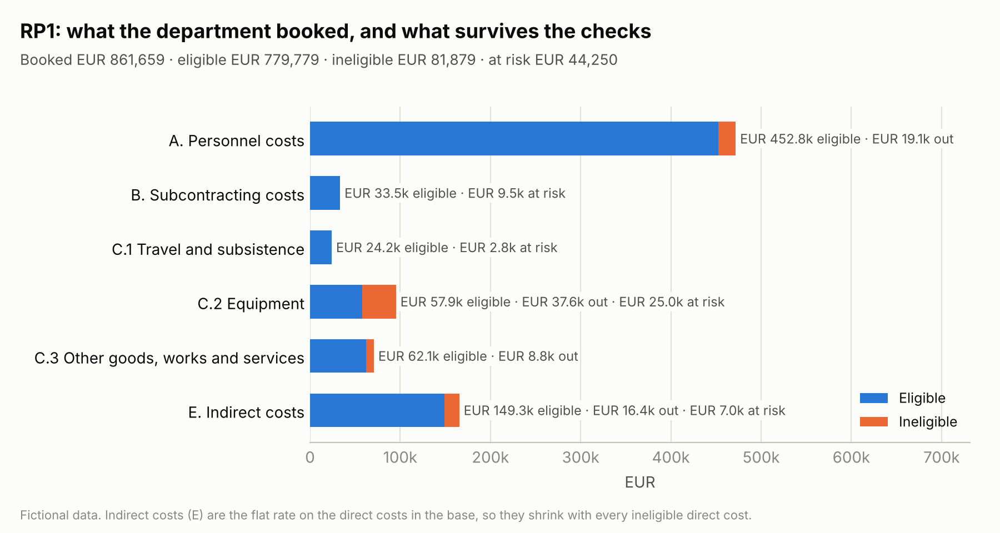
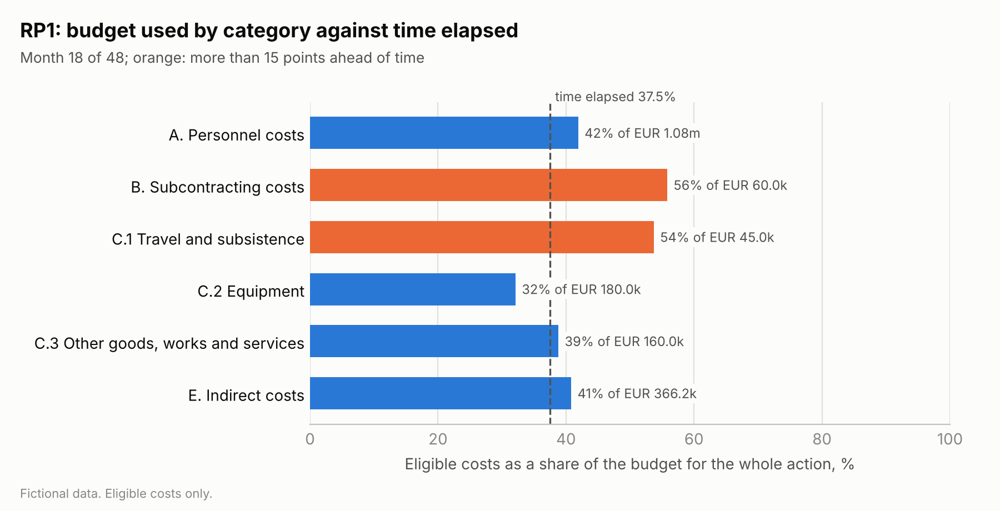
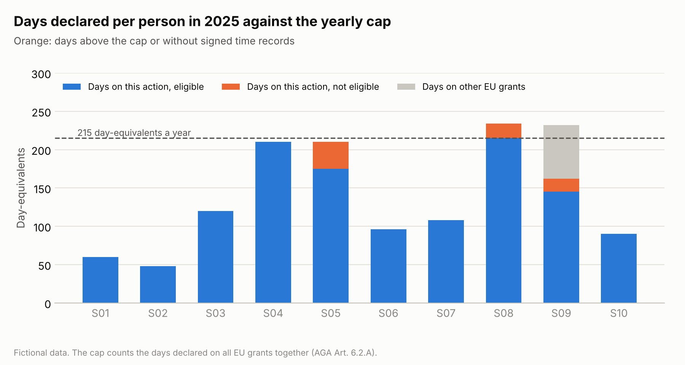
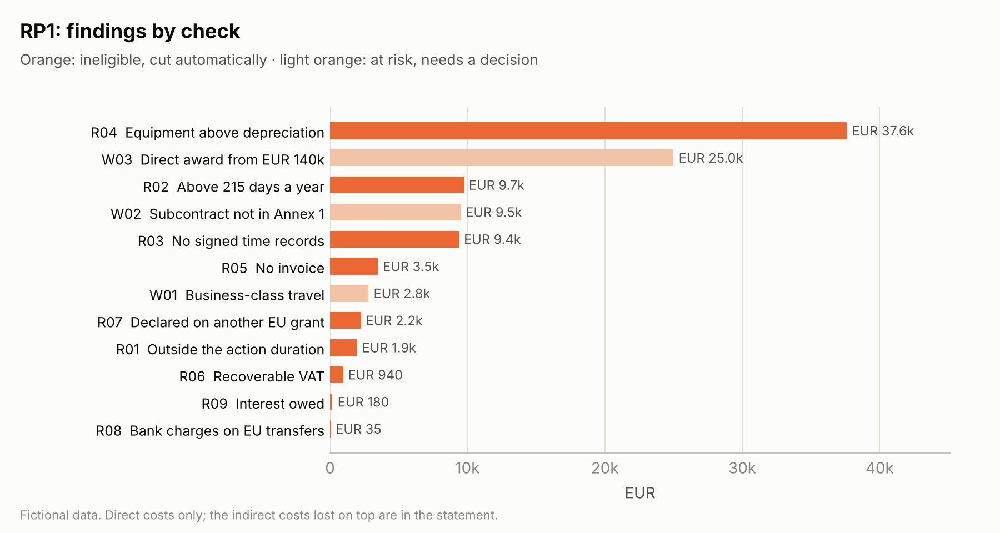
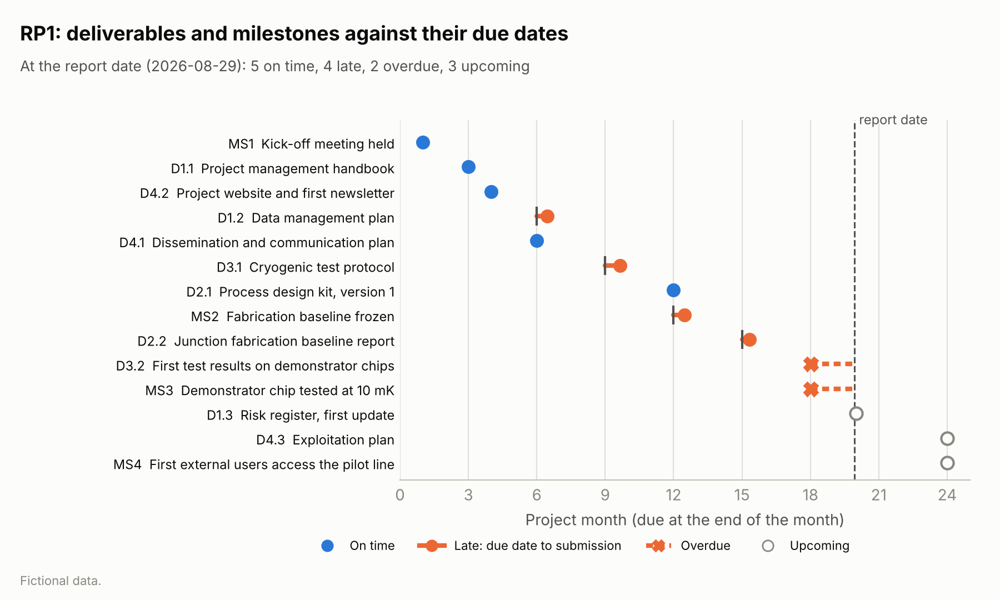

# QPL-DEMO: financial report, RP1 (2025-01-01 to 2026-06-30)

*Fictional project and data, produced by `python -m grantcheck --period RP1`.
Rules: Horizon Europe (Chips JU research and innovation action under Horizon Europe (fictional set-up)), indirect costs 25%
flat rate, EU funding rate 50%.*

## Key figures

| | EUR |
| --- | ---: |
| Booked to the project by the department | 861,658.82 |
| Eligible after the checks | 779,779.38 |
| Ineligible (cut, including the indirect costs on them) | 81,879.44 |
| At risk: eligible only if a decision or document comes through | 44,250.00 |
| Indirect costs included in the eligible total | 149,255.88 |
| EU contribution requested (50% of the eligible costs) | 389,889.69 |
| Not covered by the EU: national co-funding or own resources | 389,889.69 |

Month 18 of 48 (37.5% of the action);
41.2% of the total budget used.
15 findings make costs ineligible and 3 need a decision.

## Points for the coordinator

- **B. Subcontracting costs** has used 56% of its budget at 37.5% of the action: plan the remaining spending or a transfer between categories.
- **C.1 Travel and subsistence** has used 54% of its budget at 37.5% of the action: plan the remaining spending or a transfer between categories.
- **WP3 Cryogenic testing** has used 51.7 person-months against about 37.5 expected by now (52% of its plan): check that the remaining work fits the remaining effort.
- **WP1 Project management** has 9.0 eligible person-months against about 15.0 expected by now: check whether time is being worked but not recorded.
- **WP4 Dissemination and exploitation** has 4.8 eligible person-months against about 7.5 expected by now: check whether time is being worked but not recorded.
- Audit certificate: EUR 389,890 of EU contribution requested so far, 91% of the EUR 430,000 threshold. At this pace the total reaches about EUR 1,039,706, so a certificate on the financial statements (CFS) will be due with the final report: budget the audit fee now.
- Overdue at the report date: D3.2 First test results on demonstrator chips (60 days); MS3 Demonstrator chip tested at 10 mK (60 days). Explain the delay and the new date in the technical report.
- 4 other items were submitted late (on average 15 days).
- Personnel findings concern 4 people (S05, S08, S09, S10): fix the time records and the cap before the report is submitted.

## Financial statement by cost category

| Category | Budget (action) | Booked | Eligible | Ineligible | At risk | Budget used |
| --- | ---: | ---: | ---: | ---: | ---: | ---: |
| A. Personnel costs | 1,080,000.00 | 471,934.87 | 452,837.20 | 19,097.67 | 0.00 | 41.9% |
| B. Subcontracting costs | 60,000.00 | 33,500.00 | 33,500.00 | 0.00 | 9,500.00 | 55.8% |
| C.1 Travel and subsistence | 45,000.00 | 24,178.69 | 24,178.69 | 0.00 | 2,800.00 | 53.7% |
| C.2 Equipment | 180,000.00 | 95,466.66 | 57,866.66 | 37,600.00 | 25,000.00 | 32.1% |
| C.3 Other goods, works and services | 160,000.00 | 70,946.84 | 62,140.95 | 8,805.89 | 0.00 | 38.8% |
| D. Other cost categories | 0.00 | 0.00 | 0.00 | 0.00 | 0.00 |  |
| E. Indirect costs | 366,250.00 | 165,631.76 | 149,255.88 | 16,375.88 | 6,950.00 | 40.8% |
| Total | 1,891,250.00 | 861,658.82 | 779,779.38 | 81,879.44 | 44,250.00 | 41.2% |

## Findings and actions

| Check | Line | Status | EUR | Finding | Action |
| --- | --- | --- | ---: | --- | --- |
| R04 | E-01 | ineligible | 35,200.00 | Microwave signal generator: declared EUR 48,000.00, depreciation for the period EUR 12,800.00 (price EUR 48,000, 60 months' life, 100% use) | Declare only the depreciation for the months of use, times the share of use for the action. |
| R02 | S09 2025 | ineligible | 5,218.60 | S09: 162 days on this action + 70 on other EU grants in 2025; at most 145 can be declared here | Declare at most the remaining days; check the days declared on the person's other EU grants. |
| R03 | S05 2025 | ineligible | 5,046.51 | S05: 35 days in 2025-09, 2025-10 without a monthly declaration signed by the person and the supervisor | Collect the signed records; if they cannot be produced, remove the cost. |
| R02 | S08 2025 | ineligible | 4,506.98 | S08: 234 days on this action in 2025; at most 215 can be declared here | Declare at most the remaining days; check the days declared on the person's other EU grants. |
| R03 | S10 2026 | ineligible | 4,325.58 | S10: 30 days in 2026-03, 2026-04 without a timesheet signed by the person and the supervisor | Collect the signed records; if they cannot be produced, remove the cost. |
| R04 | E-06 | ineligible | 2,400.00 | Vector network analyser: declared EUR 8,000.00, depreciation for the period EUR 5,600.00 (price EUR 60,000, 60 months' life, 70% use) | Declare only the depreciation for the months of use, times the share of use for the action. |
| R07 | C-016 | ineligible | 2,234.32 | Cleanroom consumables (wafers, resist): also charged to ERC-DEMO | Keep the cost in one grant only. |
| R01 | C-900 | ineligible | 1,950.00 | Cleanroom consumables (delivered before the start), dated 2024-12-18; the action runs 2025-01-01 to 2028-12-31 | Remove from the claim and charge it to the department's own funds. |
| R05 | C-011 | ineligible | 1,782.65 | Liquid helium delivery (Cryogenic gas supplier), no invoice reference | File the invoice and the proof of payment, or remove the cost. |
| R05 | C-012 | ineligible | 1,683.59 | Liquid helium delivery (Cryogenic gas supplier), no invoice reference | File the invoice and the proof of payment, or remove the cost. |
| R06 | C-005 | ineligible | 351.54 | Liquid helium delivery (commercial testing activity): EUR 351.54 of recoverable VAT | Declare the cost net of VAT. |
| R06 | C-007 | ineligible | 323.10 | Liquid helium delivery (commercial testing activity): EUR 323.10 of recoverable VAT | Declare the cost net of VAT. |
| R06 | C-006 | ineligible | 265.69 | Liquid helium delivery (commercial testing activity): EUR 265.69 of recoverable VAT | Declare the cost net of VAT. |
| R09 | F-02 | ineligible | 180.00 | Late-payment interest paid to a supplier | Remove: interest is never eligible. |
| R08 | F-01 | ineligible | 35.00 | Bank charge on the transfer of the EU pre-financing | Remove from direct costs. |
| W03 | E-04 | at risk | 25,000.00 | Cryogenic probe station: EUR 150,000 awarded directly | Check the procurement file: from EUR 140 000 a negotiated procedure with at least five operators is required. |
| W02 | SC-02 | at risk | 9,500.00 | SC-02: Set-up of a data-management platform | Ask the granting authority to approve it (amendment, or approval in the periodic report). |
| W01 | T-019 | at risk | 2,800.00 | Conference travel: APS March Meeting, USA: business class; economy fare about EUR 1,350 | Justify it under the travel rules, or declare only the economy fare. |

## Person-months by work package

| WP | Work package | Planned PM (action) | Expected PM to date | Eligible PM | Planned PM used |
| --- | --- | --- | --- | --- | ---: |
| WP1 | Project management | 40 | 15.0 | 9.0 | 22.6% |
| WP2 | Device fabrication | 100 | 37.5 | 42.3 | 42.3% |
| WP3 | Cryogenic testing | 100 | 37.5 | 51.7 | 51.7% |
| WP4 | Dissemination and exploitation | 20 | 7.5 | 4.8 | 24.0% |

One person-month = 215 / 12 = 17.9 day-equivalents.

## Deliverables and milestones

Status at the report date, 2026-08-29.

| ID | Type | Title | WP | Due | Submitted | Status | Days late |
| --- | --- | --- | --- | --- | --- | --- | --- |
| MS1 | milestone | Kick-off meeting held | WP1 | 2025-01-31 | 2025-01-22 | on time | 0 |
| D1.1 | deliverable | Project management handbook | WP1 | 2025-03-31 | 2025-03-28 | on time | 0 |
| D4.2 | deliverable | Project website and first newsletter | WP4 | 2025-04-30 | 2025-04-30 | on time | 0 |
| D1.2 | deliverable | Data management plan | WP1 | 2025-06-30 | 2025-07-14 | late | 14 |
| D4.1 | deliverable | Dissemination and communication plan | WP4 | 2025-06-30 | 2025-06-30 | on time | 0 |
| D3.1 | deliverable | Cryogenic test protocol | WP3 | 2025-09-30 | 2025-10-20 | late | 20 |
| D2.1 | deliverable | Process design kit, version 1 | WP2 | 2025-12-31 | 2025-12-19 | on time | 0 |
| MS2 | milestone | Fabrication baseline frozen | WP2 | 2025-12-31 | 2026-01-15 | late | 15 |
| D2.2 | deliverable | Junction fabrication baseline report | WP2 | 2026-03-31 | 2026-04-10 | late | 10 |
| D3.2 | deliverable | First test results on demonstrator chips | WP3 | 2026-06-30 |  | overdue | 60 |
| MS3 | milestone | Demonstrator chip tested at 10 mK | WP3 | 2026-06-30 |  | overdue | 60 |
| D1.3 | deliverable | Risk register, first update | WP1 | 2026-08-31 |  | upcoming | 0 |
| MS4 | milestone | First external users access the pilot line | WP2 | 2026-12-31 |  | upcoming | 0 |
| D4.3 | deliverable | Exploitation plan | WP4 | 2026-12-31 |  | upcoming | 0 |

## Reporting calendar and audit certificate

Each report is due 60 days after its period ends; payment follows within
90 days if the report is sent on the due date and accepted as it stands.

| Period | From | To | Report | Report due | Payment | Payment by |
| --- | --- | --- | --- | --- | --- | --- |
| RP1 | 2025-01-01 | 2026-06-30 | Periodic report | 2026-08-29 | Interim payment | 2026-11-27 |
| RP2 | 2026-07-01 | 2027-12-31 | Periodic report | 2028-02-29 | Interim payment | 2028-05-29 |
| RP3 | 2028-01-01 | 2028-12-31 | Periodic and final report | 2029-03-01 | Payment of the balance | 2029-05-30 |

- Certificate on the financial statements (CFS): due with the final report if the EU contribution requested reaches EUR 430,000 over the whole action (the flat rate for indirect costs counts too). So far: EUR 389,889.69 (90.7%); at this pace: about EUR 1,039,706.
- Audits by the granting authority can start until 2031-05-30
  (2 years after the balance, if it is paid by 2029-05-30).
- Keep every supporting document until 2034-05-30 (5 years after the balance).

## Figures

